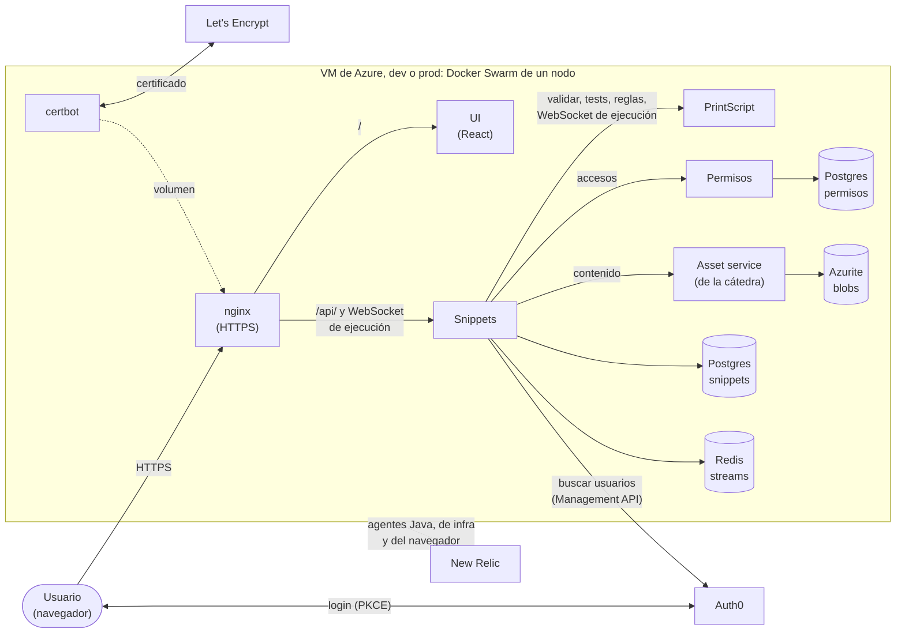
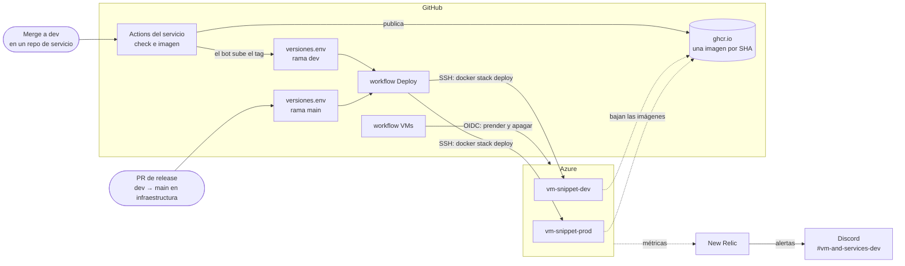

# Arquitectura

Dos diagramas, porque responden dos preguntas distintas: qué pasa cuando un usuario usa la app, y qué pasa cuando alguien mergea un PR. Están en Mermaid para que se actualicen en el mismo PR que cambia lo que dibujan.

## Qué corre en una VM

Dev y prod son la misma foto: cada una es una VM de Azure con un Docker Swarm de un nodo y el mismo `stack.yml`. Cambian el dominio y la versión de cada imagen.

Cómo se lee, con el ejemplo de crear un snippet:

1. El navegador se loguea contra Auth0 y recibe un token. Con ese token le pide a nginx `POST /api/snippets`.
2. nginx termina el HTTPS y le pasa el pedido a Snippets sin el `/api`. Todo lo que no es `/api/` va a la UI.
3. Snippets valida el token y le pide a PrintScript que valide el código, reenviando el mismo token.
4. Guarda el contenido en el asset service (que lo guarda en Azurite), registra al dueño en Permisos y recién después escribe la fila en su base. Si algo falla en el medio, borra lo que ya había escrito.

Decisiones que se ven en el dibujo:

- **Una sola puerta de entrada.** nginx es lo único que publica puertos (80 y 443). PrintScript, Permisos y el asset service no se ven desde afuera: el navegador solo le habla a Snippets, y Snippets a los demás. Por eso Permisos puede confiar en que lo llama Snippets con el token del usuario.
- **Una base por servicio.** Snippets no lee la base de Permisos ni al revés: si necesita algo del otro, se lo pide por HTTP. Cada servicio es dueño de sus datos y puede cambiar su esquema sin romper al otro.
- **El token del usuario viaja de punta a punta.** PrintScript y Permisos también lo validan, así que ninguno confía solo en estar en la red interna. La única llamada con un token propio de Snippets es la de la Management API de Auth0, para buscar usuarios al compartir.
- **La ejecución interactiva es un WebSocket encadenado**: navegador ↔ nginx ↔ Snippets ↔ PrintScript. Snippets hace de relay y es el que decide si el usuario puede ejecutar ese snippet.
- **Redis** es la cola de los trabajos en segundo plano de Snippets (linteo y formateo automáticos), con streams y grupos de consumidores.
- **Fuera del stack**: el agente de infraestructura de New Relic corre como un contenedor aparte en la VM (necesita `privileged`, que Swarm no soporta). Detalle en [Observabilidad](observabilidad.md).

## Cómo llega el código a las VMs

- **La imagen se construye una sola vez**, al mergear en `dev`, y se identifica por el SHA del commit. Prod corre exactamente la misma imagen que se probó en dev: el release es copiar `versiones.env` de `dev` a `main`, no volver a construir. Lo que cambia entre entornos es la configuración, que sale de los Environments de GitHub (factor III de Twelve-Factor).
- **La rama decide el entorno**: lo que cambia en `dev` se despliega en dev y lo que cambia en `main`, en prod.
- **El deploy no necesita que nadie entre a la VM.** Entra por SSH con la clave del Environment, y el workflow VMs prende y apaga con una identidad de Azure por OIDC, sin contraseñas guardadas. Detalle en [Despliegue](despliegue.md) y [VMs](vms.md).
- **Las VMs se pueden tirar**: las imágenes viven en ghcr.io y no en la VM, y cada deploy borra las que ya no se usan.
